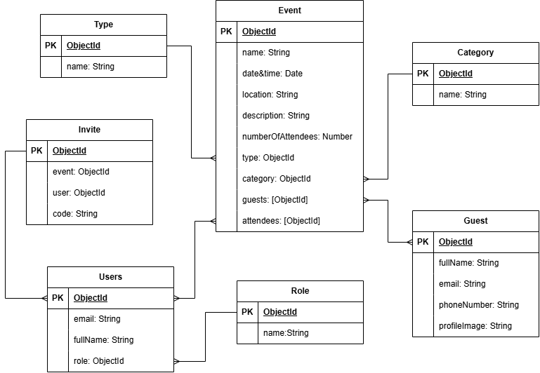

# Project Name

## Technologies Used

## Overview

## User Stories
1. As a user (Event Creator), I want to be able to create new events, so I can organize business gatherings and activities.
2. As a user (Event Creator), I want to be able to view all events, so I can browse the events available on the platform.
3. As a user (Event Creator), I want to be able to view event details, so I can access information about a specific event.
4. As a user (Event Creator), I want to be able to edit event details, so I can keep event information accurate and updated.
5. As a user (Event Creator), I want to be able to delete events, so I can remove cancelled or unwanted events.
6. As a user (Event Creator), I want to be able to assign a category to an event, so I can organize events based on their industry or purpose.
7. As a user (Event Creator), I want to be able to assign an event type, so I can specify the format of the event.
8. As a user (Event Creator), I want to be able to set the event date, time, and location, so guests know when and where the event will take place.
9. As a user (Event Creator), I want to be able to set the expected number of attendees, so I can plan the event accordingly.
10. As a user (Event Creator), I want to be able to add new guests, so I can build a guest list for my events.
11. As a user (Event Creator), I want to be able to view all guests, so I can manage my guest list.
12. As a user (Event Creator), I want to be able to search for guests by name or email, so I can quickly find a specific guest.
13. As a user (Event Creator), I want to be able to assign guests to an event, so I can manage the attendees of each event.
14. As a user (Normal User), I want to be able to register using my full name and email, so I can access the platform.
15. As a user (Normal User), I want to be able to log in to my account, so I can access my invitations and events.
16. As a user (Normal User), I want to be able to view all available events, so I can discover upcoming events.
17. As a user (Normal User), I want to be able to view event details, so I can learn more about an event before attending.
18. As a user (Normal User), I want to be able to view my invitations, so I can keep track of events I have been invited to.
19. As a user (Normal User), I want to be able to view my unique invitation code, so I can use it to identify my invitation.
20. As a user (Normal User), I want to be able to view my upcoming events, so I can keep track of events I plan to attend.
21. As a user (Event Creator), I want to be able to view the total number of attendees, so I can monitor event attendance.
22. As a user (Normal User), I want to be able to join an event.
23. As a user (Normal User), I want to be able to drop from events I joined .

## Database Design

## Routes

## Screenshots

## Features

## Future Enhancements

## Credits

## Getting Started

